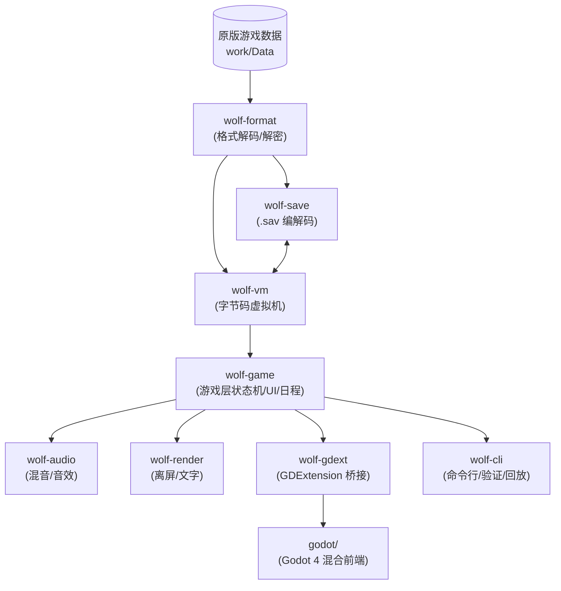

<div align="center">

# Imouto! Life ～単色～ — 数据级游戏重构运行时

[English](README_EN.md) | [简体中文](README.md)

<p align="center">
  <a href="https://www.rust-lang.org/"></a>
  <a href="https://godotengine.org/"></a>
  <a href="#"></a>
  <a href="CHANGELOG.md"></a>
</p>

《妹！生活 ～単色～》（いぬすく 2019，WOLF RPG Editor，zh-CN 汉化 2.03）的高性能现代化跨平台重构工程。

基于 **Rust 核心字节码解释器** 与 **Godot 4 GDExtension 混合架构**，实现对原版底层逻辑与音画行为的 100% 像素级对齐，同时提供高分辨率无级缩放、跨平台双端原生运行、Mod 补丁扩展及多语言流式本地化能力。

</div>

---

## 📑 目录

- [✨ 核心特性](#-核心特性)
- [🎮 玩家下载与安装指南](#-玩家下载与安装指南)
- [🛠️ 开发者源码构建](#️-开发者源码构建)
- [🏛️ 系统架构](#️-系统架构)
- [📦 发布与打包脚本](#-发布与打包脚本)
- [📚 文档与导航中心](#-文档与导航中心)
- [🤝 参与贡献](#-参与贡献)
- [📄 免责与版权说明](#-免责与版权说明)

---

## ✨ 核心特性

- **🖥️ 跨平台双端原生支持**
  - **Windows**：原生 Windows 64位独立启动器，提供一键式 NSIS 安装程序与解压即玩的便携 ZIP。
  - **Android**：针对 ARM64 深度优化，适配移动端触控点击、长按手势与虚拟交互边界。
- **🎨 突破限制的高保真渲染**
  - 摆脱原版固定的 1024×576 分辨率束缚，支持任意窗口长宽比的无级平滑缩放与全屏抗撕裂渲染。
  - 精确还原原版渲染层级、Alpha 混合公式与文字排版（标题界面像素完全一致度达 **99.779%**）。
- **💾 原版存档无缝互通**
  - 完美兼容原版 `.sav` 二进制存档与 vardb 字典，支持双向无损读取、校验与回写。
- **🌐 现代化多语言与 Mod 扩展**
  - 内置基于 TSV 的本地化流式替换管线，支持中、日、英等多语言快速切换。
  - 支持记录级二进制数据补丁与音频素材热覆盖，无需重新封包即可加载社区 Mod。
- **🔍 实时调试与性能观测**
  - **F2 统计看板**：实时监视核心数值流转与事件达成进度。
  - **F3 运行时 Inspector**：可视化查看图片层（Pictures）、事件状态机与当前执行堆栈。
  - **F4 消息历史回顾**：随时查看过往对话日志（Message Log）。

---

## 🎮 玩家下载与安装指南

### 1. 获取发行包

请前往 [Releases 页面](https://github.com/Nana7mi0721/Imouto-Life-Monochrome/releases) 下载对应平台的最新正式版本（当前最新版本：`v0.1.1`）：

- **Windows 用户**：
  - `ImoutoLife-0.1.1-windows-amd64-setup.exe`：一键安装程序（包含桌面快捷方式与控制面板卸载集成）。
  - `ImoutoLife-0.1.1-windows-amd64.zip`：便携压缩包（解压至任意目录双击 `Imouto Life.exe` 即可运行）。
  - `ImoutoLife-0.1.1-windows-amd64-setup-slim.exe` / `ImoutoLife-0.1.1-windows-amd64-slim.zip`：媒体重编码的精简版，与标准版存档格式一致。
- **Android 用户**：
  - `ImoutoLife-0.1.1-android-arm64.apk`：直接安装至安卓设备。
  - `ImoutoLife-0.1.1-android-arm64-slim.apk`：精简媒体版。
- 每个平台目录中的 `SHA256SUMS.txt` 提供当前版本发行文件的完整校验值。

### 2. 准备游戏数据

> **重要说明**：根据版权与资产隔离原则，发行包为纯净运行时，不包含游戏原始美术与音频素材。

首次启动前，请将合法获取的原版游戏解包数据（包含 `Data/` 目录）放置于可执行文件同级目录即可自动识别加载。

---

## 🛠️ 开发者源码构建

### 环境要求

- **操作系统**：Windows 10/11 或 Linux
- **Rust 工具链**：Stable（按 [rust-toolchain.toml](rust-toolchain.toml) 推荐版本）
- **Godot 引擎**：[Godot 4.7.2-stable](https://godotengine.org/)
- **本地测试数据**：将解包后的原始游戏数据放置于 `work/Data`（此目录已被 gitignore）

### 1. 载入环境配置

推荐使用 Git-Bash 终端执行开发命令：

```bash
# 自动定位项目根目录并加载工具链与环境路径
source tools/env.sh
```

PowerShell 用户可执行：

```powershell
. tools\env.ps1
```

### 2. 编译与单元测试

```bash
# 1. 编译全工作区
cargo build -q --workspace

# 2. 执行基础单元测试（无游戏数据时自动跳过需数据用例）
cargo test -q --workspace

# 3. 结合本地真实数据进行全量验证（必须使用绝对路径）
WOLF_DATA_ROOT="$PWD/work/Data" cargo test -q --workspace

# 4. 数据一致性基线校验
WOLF_DATA_ROOT=work/Data ./target/debug/wolf-cli.exe verify
```

### 3. Godot 前端协同运行

```bash
# 1. 编译 GDExtension 绑定库（产出 godot/bin/wolf_gdext.dll）
bash tools/build-godot.sh

# 2. 运行自动化 Headless 冒烟测试
bash tools/smoke-godot.sh

# 3. 运行 600~1800 帧长程像素与 VM 状态对齐回归
bash tools/parity-godot.sh

# 4. 启动 Godot 交互前端
"$GODOT_BIN" --path godot
```

---

## 🏛️ 系统架构

仓库采用分层解耦的 Cargo Workspace 多模块架构，前端渲染与视口捕获交由 Godot 驱动：



### Workspace 模块职责划分

| 模块 | 目录 | 核心职责 |
|---|---|---|
| `wolf-format` | `crates/wolf-format` | WOLF 引擎数据规范：Game.dat、CommonEvent、Database、mps 地图、DXArchive VER6 格式解密 |
| `wolf-save` | `crates/wolf-save` | `.sav` 存档文件读写、校验与 vardb 运行时持久化 |
| `wolf-vm` | `crates/wolf-vm` | 字节码解释执行、系统/通用变量寻址与并发调度 |
| `wolf-render` | `crates/wolf-render` | 软件离屏渲染、字符栅格化与材质 Quad 缓存 |
| `wolf-audio` | `crates/wolf-audio` | BGM / BGS / SE 音频混合与 SoundCmd 指令生命周期 |
| `wolf-game` | `crates/wolf-game` | 游戏业务层：状态流转、日程推进、HUD 绘制、相册、设置与事件交互 |
| `wolf-cli` | `crates/wolf-cli` | 独立 CLI 工具集：`verify` 校验、`precompile` 预编译、`play` 调试与捕获 |
| `wolf-launcher` | `crates/wolf-launcher` | Windows 平台静默启动外壳（转发参数并拉起运行时） |
| `wolf-gdext` | `crates/wolf-gdext` | Godot 4 C++ GDExtension 的 Rust 导出绑定（提供 `WolfGame` 节点） |
| `godot/` | `godot/` | Godot 4.7.2 场景工程：处理窗口视口适配、音视频输出、触控与输入分发 |

---

## 📦 发布与打包脚本

详细打包参数与发布标准请查阅 [docs/release/PACKAGING.md](docs/release/PACKAGING.md)：

- **Windows 发行包打包**：
  ```bash
  bash tools/package-godot.sh
  ```
  生成便携 ZIP 与 NSIS 安装程序于 `work/out/dist/` 目录下。
- **Android APK 打包**：
  ```bash
  bash tools/package-android.sh
  ```
  自动完成 ARM64 交叉编译、资源打包、Zipalign 对齐与 Release 签名。

---

## 📚 文档与导航中心

- **[docs/README.md](docs/README.md)**：全量文档地图（现行事实、审计记录与历史归档）。
- **[CONTRIBUTING.md](CONTRIBUTING.md)**：开发者贡献指引与代码协作准则。
- **[AGENTS.md](AGENTS.md)**：自动化开发与多代理协同契约。
- **[CHANGELOG.md](CHANGELOG.md)**：版本演进与发布历史。
- **[tools/README.md](tools/README.md)**：自动化构建、测试与逆向工具手册。
- **[docs/plans/](docs/plans)**：系统演进与移动端优化规划方案。
- **[docs/engine/ENGINE_BEHAVIOR.md](docs/engine/ENGINE_BEHAVIOR.md)**：WOLF 引擎底层行为与事件契约。

---

## 🤝 参与贡献

欢迎提出 Issue 或 Pull Request！在开始之前：
1. 请阅读 [CONTRIBUTING.md](CONTRIBUTING.md) 了解代码规范与分支协作准则。
2. 确保本地 `cargo check -q --workspace` 与 `cargo test -q --workspace` 全部通过。
3. 遵循代码与素材严格隔离原则，切勿提交任何原始受限商业素材。

---

## 📄 免责与版权说明

原作游戏版权、商标及衍生资产说明详见 [DISCLAIMER.md](DISCLAIMER.md)。
