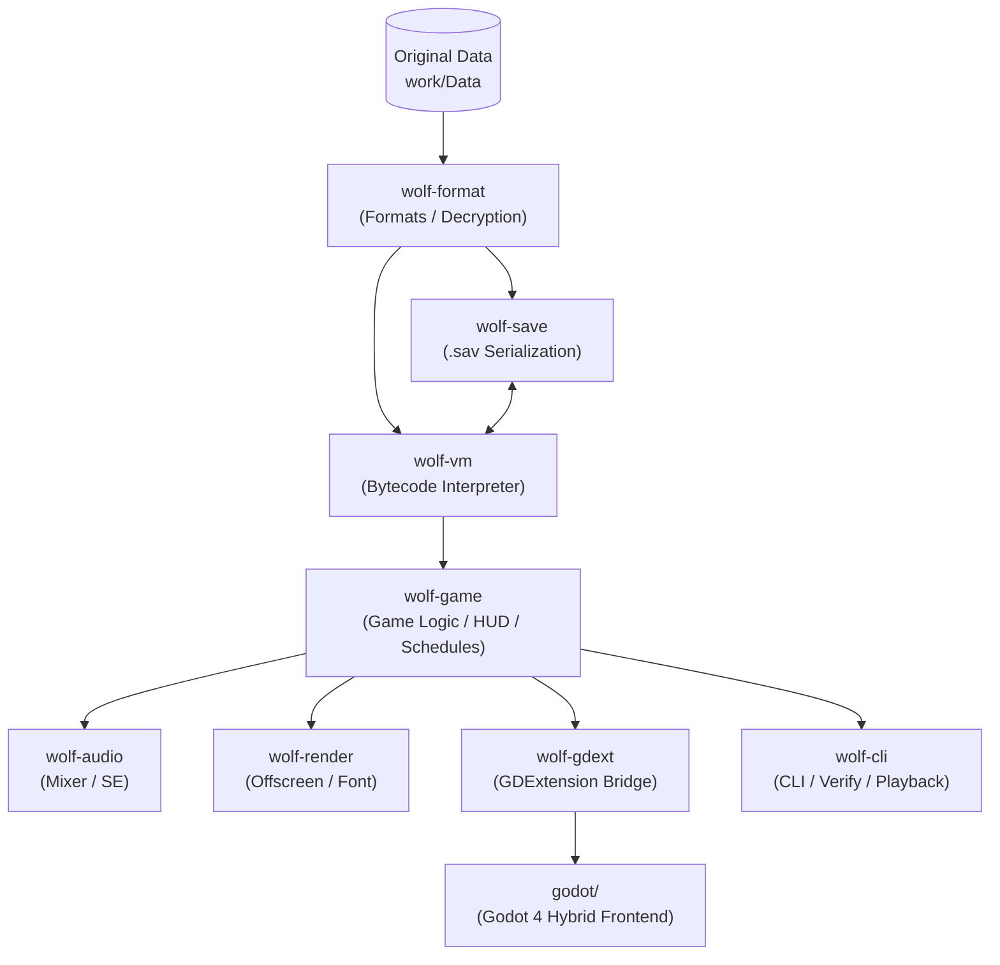

<div align="center">

# Imouto! Life ~Monochrome~ — Data-Driven Game Runtime Reimplementation

[English](README_EN.md) | [简体中文](README.md)

<p align="center">
  <a href="https://www.rust-lang.org/"></a>
  <a href="https://godotengine.org/"></a>
  <a href="#"></a>
  <a href="CHANGELOG.md"></a>
</p>

A high-performance, modern cross-platform reimplementation of *Imouto! Life ~Monochrome~* (inusuku 2019, WOLF RPG Editor).

Powered by a **Rust bytecode VM core** combined with a **Godot 4 GDExtension hybrid frontend**, achieving 100% pixel-level behavioral fidelity with the original engine while providing modern enhancements such as arbitrary viewport scaling, dual-platform Windows/Android support, mod patching, and runtime TSV localization.

</div>

---

## 📑 Table of Contents

- [✨ Key Features](#-key-features)
- [🎮 Player Quick Start & Download](#-player-quick-start--download)
- [🛠️ Building from Source](#️-building-from-source)
- [🏛️ Architecture](#️-architecture)
- [📦 Packaging & Distribution](#-packaging--distribution)
- [📚 Documentation Index](#-documentation-index)
- [🤝 Contributing](#-contributing)
- [📄 Disclaimer & License](#-disclaimer--license)

---

## ✨ Key Features

- **🖥️ Native Cross-Platform Support**
  - **Windows**: Clean standalone launcher, portable ZIP, and full NSIS installer integration.
  - **Android**: ARM64 native dynamic library support with touch-optimized gesture and interaction boundaries.
- **🎨 High-Fidelity Rendering Beyond Original Limits**
  - Break free from the fixed 1024x576 resolution with smooth arbitrary scaling and tear-free fullscreen rendering.
  - Pixel-exact reproduction of rendering layers, alpha blending math, and typography (**99.779%** pixel match on the title screen).
- **💾 Seamless Original Save Interoperability**
  - Fully compatible with original `.sav` binary files and `vardb` dictionary with lossless round-trips.
- **🌐 Localization & Modding Extensions**
  - Built-in TSV-based streaming localization pipeline supporting dynamic language switching.
  - Record-level binary database patches and hot audio asset overrides without repacking archives.
- **🔍 Runtime Inspector & Developer Overlays**
  - **F2**: Statistics and event progression monitor.
  - **F3**: Real-time Picture layer and VM state inspector.
  - **F4**: Message history backlog review.

---

## 🎮 Player Quick Start & Download

### 1. Download Release Packages

Head to the [Releases page](https://github.com/Nana7mi0721/Imouto-Life-Monochrome/releases) to grab the latest build (current version: `v0.1.2`):

- **Windows**:
  - `ImoutoLife-0.1.2-windows-amd64-setup.exe`: NSIS installer with desktop shortcuts and uninstaller integration.
  - `ImoutoLife-0.1.2-windows-amd64.zip`: Portable package (extract and double-click `Imouto Life.exe`).
  - `ImoutoLife-0.1.2-windows-amd64-setup-slim.exe` / `ImoutoLife-0.1.2-windows-amd64-slim.zip`: Media-reencoded slim builds with the same save format.
- **Android**:
  - `ImoutoLife-0.1.2-android-arm64.apk`: Sideload directly to your Android device.
  - `ImoutoLife-0.1.2-android-arm64-slim.apk`: Slim-media build.
- **iOS**:
  - `ImoutoLife-0.1.2-ios-arm64-unsigned.ipa`: Standard full build; re-sign with Sideloadly or your Apple ID.
  - `ImoutoLife-0.1.2-ios-arm64-unsigned-slim.ipa`: Slim-media full build with the same signing flow.
- The release-root `SHA256SUMS.txt` covers all eight platform packages.

### 2. Game Data

Official Windows, Android and iOS releases already include the required release
`Data/`, media pack and clean `System.sav`, so they are ready to play after
installation. Only source-built CLI debug packages require legally acquired
unpacked game data in `work/Data` or beside the executable.

---

## 🛠️ Building from Source

### Prerequisites

- **OS**: Windows 10/11 or Linux
- **Rust Toolchain**: Stable (see [rust-toolchain.toml](rust-toolchain.toml))
- **Godot Engine**: [Godot 4.7.2-stable](https://godotengine.org/)
- **Game Data**: Place extracted data in `work/Data` (git-ignored)

### 1. Environment Setup

Using Git-Bash is recommended:

```bash
# Automatically resolves project root and sets toolchain paths
source tools/env.sh
```

For PowerShell:

```powershell
. tools\env.ps1
```

### 2. Compilation & Tests

```bash
# Build workspace
cargo build -q --workspace

# Run offline unit tests (data-dependent tests are skipped safely)
cargo test -q --workspace

# Full regression testing with local game data (absolute path required)
WOLF_DATA_ROOT="$PWD/work/Data" cargo test -q --workspace

# Baseline verification
WOLF_DATA_ROOT=work/Data ./target/debug/wolf-cli.exe verify
```

### 3. Running with Godot Frontend

```bash
# 1. Build GDExtension library (outputs godot/bin/wolf_gdext.dll)
bash tools/build-godot.sh

# 2. Run automated headless smoke test
bash tools/smoke-godot.sh

# 3. Run parity alignment tests (600-1800 frames)
bash tools/parity-godot.sh

# 4. Launch Godot frontend
"$GODOT_BIN" --path godot
```

---

## 🏛️ Architecture

The workspace follows a layered modular Cargo architecture with Godot driving rendering and viewport presentation:



### Workspace Crates

| Crate | Directory | Responsibility |
|---|---|---|
| `wolf-format` | `crates/wolf-format` | WOLF specifications: Game.dat, CommonEvent, Database, mps, DXArchive VER6 |
| `wolf-save` | `crates/wolf-save` | `.sav` persistence, validation, and vardb state mapping |
| `wolf-vm` | `crates/wolf-vm` | Bytecode execution loop, variable address resolution, scheduling |
| `wolf-render` | `crates/wolf-render` | Offscreen software rendering, typography, quad caching |
| `wolf-audio` | `crates/wolf-audio` | BGM / BGS / SE mixing, SoundCmd lifecycle management |
| `wolf-game` | `crates/wolf-game` | Game layer: schedules, HUD, gallery, settings, event interaction |
| `wolf-cli` | `crates/wolf-cli` | Standalone CLI tools: `verify`, `precompile`, `play`, capture |
| `wolf-launcher` | `crates/wolf-launcher` | Console-free Windows runner wrapper |
| `wolf-gdext` | `crates/wolf-gdext` | Rust GDExtension bindings for Godot 4 (exports `WolfGame`) |
| `godot/` | `godot/` | Godot 4.7.2 project handling viewports, touch, and audio playback |

---

## 📦 Packaging & Distribution

See [docs/release/PACKAGING.md](docs/release/PACKAGING.md) for full delivery pipelines:

- **Windows Distribution**:
  ```bash
  bash tools/package-godot.sh
  ```
  Generates portable ZIP and NSIS installer under `work/out/dist/`.
- **Android APK**:
  ```bash
  bash tools/package-android.sh
  ```
  Handles ARM64 cross-compilation, resource staging, zipalign, and release signing.

---

## 📚 Documentation Index

- **[docs/README.md](docs/README.md)**: Master documentation index.
- **[CONTRIBUTING.md](CONTRIBUTING.md)**: Developer contribution guidelines.
- **[AGENTS.md](AGENTS.md)**: Automation and multi-agent development guidelines.
- **[CHANGELOG.md](CHANGELOG.md)**: Release history and version updates.
- **[tools/README.md](tools/README.md)**: Tooling and script reference manual.
- **[docs/plans/](docs/plans)**: Architectural plans and touch optimization RFCs.
- **[docs/engine/ENGINE_BEHAVIOR.md](docs/engine/ENGINE_BEHAVIOR.md)**: WOLF engine behavioral specification.

---

## 🤝 Contributing

Issues and Pull Requests are welcome! Before getting started:
1. Review [CONTRIBUTING.md](CONTRIBUTING.md) for conventions and workflow details.
2. Ensure `cargo check -q --workspace` and `cargo test -q --workspace` succeed locally.
3. Observe asset isolation policies: never commit proprietary commercial assets.

---

## 📄 Disclaimer & License

All copyrights, trademarks, and intellectual property of the original game belong to their original author/team (*inusuku*). See [DISCLAIMER.md](DISCLAIMER.md).
