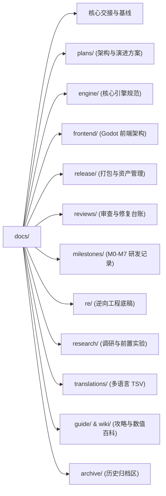

# 文档索引地图（docs/README.md）

本文件是《妹！生活 ～単色～》Rust 重构工程的**唯一全局文档导航中心**。所有文档按功能领域进行模块化收归：

---

## 0. 状态约定

| 状态标签 | 说明 |
|---|---|
| **现行 · 先读** | 现行且必须优先阅读的入口或核心规范 |
| **现行 · 权威** | 核心架构与逻辑事实来源，结论与数据可直接引用 |
| **现行 · 记录** | 现行的任务进度台账或执行日志 |
| **历史研发** | 研发攻坚阶段的历史备忘与推导过程（以现行规范为准） |
| **已归档** | 已被新设计或总报告取代，移入 `docs/archive/` 作为证据链保留 |

---

## 1. 核心交接与协作规范（先读）

| 文档 | 状态 | 内容与定位 |
|---|---|---|
| [HANDOFF_M0.md](HANDOFF_M0.md) | **现行 · 先读** | 全局交接总览：架构地图、实测硬事实、世代差异、陷阱与避坑指南、当前状态摘要 |
| [HANDOFF_PROGRESS.md](HANDOFF_PROGRESS.md) | 现行 · 记录 | 完整历史进度台账（自 M0 骨架搭建至 0.1.0 发包及后续各项收尾记录） |
| [BASELINE.json](BASELINE.json) | **现行 · 权威** | 自动化测试与一致性校验基线（包含 Game.dat 字段、公共事件、地图事件及 DXArchive 统计） |
| [REFERENCE.md](REFERENCE.md) | 现行 · 参考 | 日文原版资源路径、攻略参考链接、10 张实机截图与存档样本索引 |
| [../AGENTS.md](../AGENTS.md) | **现行 · 必读** | 自动化开发与协作约定（写作用域隔离、测试路径要求、不抢前台、内容安全） |
| [../CONTRIBUTING.md](../CONTRIBUTING.md) | 现行 · 指南 | 开发者贡献指南（环境准备、源码编译、测试流程、规范约束） |
| [../CHANGELOG.md](../CHANGELOG.md) | 现行 · 历史 | 版本发布与变更日志（语义化版本控制） |
| [../DISCLAIMER.md](../DISCLAIMER.md) | 现行 · 法律 | 原作知识产权与非商业研究免责声明、纯代码与商业资产隔离原则 |

---

## 2. 架构方案与演进规划（[plans/](plans/README.md)）

存放重大架构重构、功能演进、移动端移植及交互优化方案（RFC/Plan）：

- [plans/README.md](plans/README.md) — 方案目录索引
- [plans/android_ui_and_interaction_optimization_plan.md](plans/android_ui_and_interaction_optimization_plan.md) — 安卓端触控交互优化与缺陷修复方案（OPT-01~05, BUG-06）

---

## 3. 核心引擎规范与行为契约（[engine/](engine/README.md)）

收拢游戏字节码解释器、指令集及底层系统行为的权威规范：

- [engine/README.md](engine/README.md) — 引擎规范导航
- [engine/ENGINE_BEHAVIOR.md](engine/ENGINE_BEHAVIOR.md) — **引擎行为全局规范**（Sys 变量寻址、Magic 地址、并发调度、定屏视口与音频语义）
- [engine/RE_GAME_EXE.md](engine/RE_GAME_EXE.md) — 原版 Game.exe 静态反编译与逆向分析记录
- [engine/OPCODE_122.md](engine/OPCODE_122.md) — Opcode 122（变量操作/算术运算/字符串指针）解码规范
- [engine/OPCODE_220_SAVE.md](engine/OPCODE_220_SAVE.md) — Opcode 220（存读档/校验和/路径注入）契约与无损往返

---

## 4. 前端与混合交互架构（[frontend/](frontend/README.md)）

Godot 4 GDExtension 混合前端设计、视口呈现与运行时调试指南：

- [frontend/README.md](frontend/README.md) — 前端架构总览与快速构建
- [frontend/GODOT_MIGRATION.md](frontend/GODOT_MIGRATION.md) — Godot 4.7.2 迁移全景（GDExtension 绑定、视口管理、输入分发与像素对齐）
- [frontend/GODOT_DEBUGGING.md](frontend/GODOT_DEBUGGING.md) — 前端调试技巧、日志开关与实机问题排查指南
- [frontend/MCP_AUDIT_PROBE.md](frontend/MCP_AUDIT_PROBE.md) — MCP 运行时自动化探针架构与无头驱动

---

## 5. 发布流水线与资产管理（[release/](release/README.md)）

多平台发包、安装器构建与仓库资产清单：

- [release/README.md](release/README.md) — 发布流水线总览
- [release/PACKAGING.md](release/PACKAGING.md) — **全平台打包指南**（Windows 便携包/NSIS 安装包、Android Release APK 签名流水线）
- [release/IOS_PRIVATE_BUILD.md](release/IOS_PRIVATE_BUILD.md) — iOS 未签名 IPA 私有构建、Data 注入与 Sideloadly 安装
- [release/ASSETS.md](release/ASSETS.md) — 素材导出工具 `wolf-cli assets`、媒体清单与数据库资源提取规范
- [release/PROJECT_ASSETS.md](release/PROJECT_ASSETS.md) — 仓库资产盘点与清理台账

---

## 6. 代码审查与修复总台账（[reviews/](reviews/README.md)）

系统性代码审查（Code Review）与缺陷闭环跟踪：

- [reviews/README.md](reviews/README.md) — 审查台账总览
- [reviews/CODE_REVIEW_4ROUND.md](reviews/CODE_REVIEW_4ROUND.md) — **第一至四轮审查总报告**（BUG-20..48 全量台账与架构建议）
- [reviews/HANDOFF_DEEP_REVIEW_FIX.md](reviews/HANDOFF_DEEP_REVIEW_FIX.md) — 深度审查修复完成交接（T0–T11 落地证据与验证结果）
- [reviews/TASKS_REMAINING_BUGS.md](reviews/TASKS_REMAINING_BUGS.md) — 缺陷任务卡分工与执行记录
- [reviews/GEMINI_FULL_AUDIT_GUIDE.md](reviews/GEMINI_FULL_AUDIT_GUIDE.md) — 全量只读审计任务书
- **分轮次修复报告**：
  - [AUDIT_2411996_FIX_REPORT.md](reviews/AUDIT_2411996_FIX_REPORT.md)
  - [AUDIT_REBUILD_FIX_REPORT.md](reviews/AUDIT_REBUILD_FIX_REPORT.md)
  - [GEMINI_REVIEW_1c76dcc_FIX_REPORT.md](reviews/GEMINI_REVIEW_1c76dcc_FIX_REPORT.md)
  - [REVIEW_9a817e4_FIX_REPORT.md](reviews/REVIEW_9a817e4_FIX_REPORT.md)
  - [LIVE_PLAY_FIX_REPORT.md](reviews/LIVE_PLAY_FIX_REPORT.md)
  - [T13_UI_REGRESSION_AUDIT.md](reviews/T13_UI_REGRESSION_AUDIT.md)
- **云端审计轮次**：[reviews/cloud_audit_2026-11-18_e716f08/](reviews/cloud_audit_2026-11-18_e716f08/)

---

## 7. 历次里程碑研发记录（[milestones/](milestones/README.md)）

收纳 M0~M7 历次研发攻坚的一手技术备忘录：

- [milestones/README.md](milestones/README.md) — 里程碑总览
- **日常与运行时（M2~M3）**：[M2_SLICE.md](milestones/M2_SLICE.md)、[M25_LIVE_UX.md](milestones/M25_LIVE_UX.md)、[M3_RUNTIME.md](milestones/M3_RUNTIME.md)、[M3_EVENT_GRAPH.md](milestones/M3_EVENT_GRAPH.md)、[M3_EVENT_MAP.md](milestones/M3_EVENT_MAP.md)、[M3_MAP_EVENTS.md](milestones/M3_MAP_EVENTS.md)、[M3_EVENT_INPUTS.md](milestones/M3_EVENT_INPUTS.md)、[M3_ENDINGS.md](milestones/M3_ENDINGS.md)、[M3_TITLE_UX.md](milestones/M3_TITLE_UX.md)、[M3_STRING_DECODE.md](milestones/M3_STRING_DECODE.md)、[M3_ASSET_REFS.md](milestones/M3_ASSET_REFS.md)、[M3_VARDB_BUG.md](milestones/M3_VARDB_BUG.md)、[M3_MANUAL_ALIGNMENT.md](milestones/M3_MANUAL_ALIGNMENT.md)
- **对等与调优（M4）**：[M4_PARITY.md](milestones/M4_PARITY.md)、[M4_HUD.md](milestones/M4_HUD.md)、[M4_SETTINGS_UI.md](milestones/M4_SETTINGS_UI.md)、[M4_PERF.md](milestones/M4_PERF.md)、[M4_V8_AUDIT.md](milestones/M4_V8_AUDIT.md)
- **超越与扩展（M5~M7）**：[M5_BEYOND.md](milestones/M5_BEYOND.md)、[M6_INPUT.md](milestones/M6_INPUT.md)、[M7_I18N.md](milestones/M7_I18N.md)、[M7_PATCH.md](milestones/M7_PATCH.md)、[M7_HOTKEYS.md](milestones/M7_HOTKEYS.md)

---

## 8. 专项专题索引

- **逆向工程底稿**：[re/README.md](re/README.md)（事件可达性、排版度量、文本字形、换图过渡）
- **调研与实验**：[research/README.md](research/README.md)（伪随机数 PRNG 实证、GPT 调研报告）
- **多语言数据**：[translations/README.md](translations/README.md)（TSV 机制与中/英/日语言包）
- **攻略叙述与数据定稿**：[guide/README.md](guide/README.md)（14 章叙述与数据定稿层）
- **百科数据手册**：[wiki/README.md](wiki/README.md)（原百科层数据手册，九册制）
- **外部参考实现**：[vendor/README.md](vendor/uberwolf-ref/LICENSE)（DXLib 与解包参考工具）
- **历史归档区**：[archive/README.md](archive/README.md)（已过时交接与历史会话快照）
